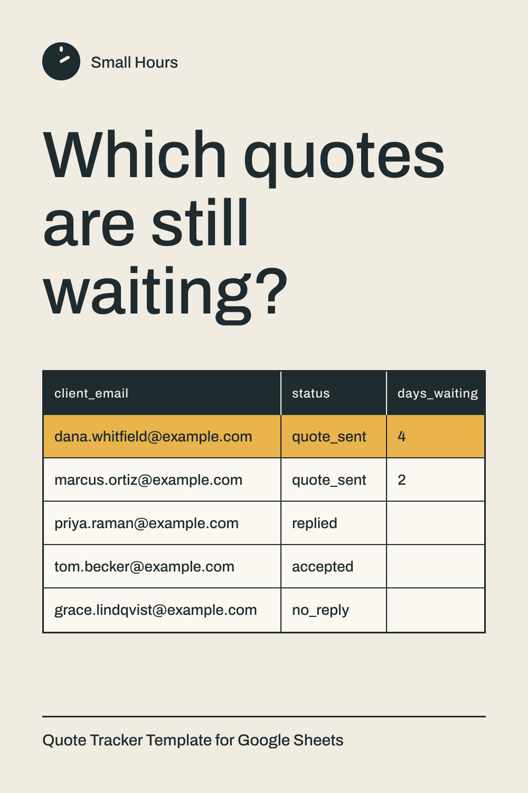
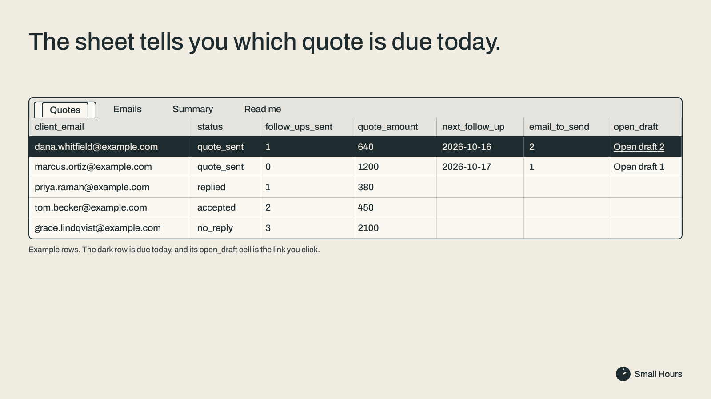

Free quote tracker template for Google Sheets

# Quote tracker for Google Sheets

You send a quote. Three days later you can't remember which ones are still waiting.

This is a free Google Sheet that keeps your quotes in one place: who you sent it to, when, how much, what happened. It is a quote tracker for the owner of a small business, built on one tab you fill in by hand.

## Get the sheet

The easiest way is to make your own copy in Google Sheets: https://payhip.com/b/z1uLh

It is free. Payhip asks for your email to send the link, and that is the only email asked for. Nothing to install, no scripts, no permissions to allow.

## What is in it

- A `Quotes` tab with the columns you need: client email, subject, date sent, status, follow-ups sent, last follow-up, amount, notes.
- A `days_waiting` column that counts the days since your last email while the status is `quote_sent`, and turns the row amber at 3 days.
- A status list (`quote_sent`, `replied`, `accepted`, `declined`, `no_reply`) and five example rows to type over. Keep row 2: the `days_waiting` formula lives there.
- A `Read me` tab with short instructions.

Leave `thread_id` blank.

## Files in this repository

| File | What it is |
|---|---|
| `Quotes.csv` | The columns of the `Quotes` tab and the five example rows. Import it into an empty Google Sheet if you prefer to start from the CSV |
| `Read-me.csv` | The text of the `Read me` tab |
| `LICENSE` | MIT, for these two files |

The `days_waiting` formula and the amber highlight are not in the CSV. They come with the copy of the sheet from the link above.

## Works for

Quotes, estimates and bids. Any business where you send a price and wait for an answer.

## What it does not do

- It does not send or read email, and it does not see that a client replied. You change the status yourself.
- It does not send follow-ups for you.

## Want the follow-up already written?

Quote Follow-Up Sheet, US$9: you click, Gmail opens the follow-up already written, you press Send. https://payhip.com/b/XhJYz

That image is the US$9 sheet, not this free one.

## Who made it

There is one person behind Small Hours, who handles the store. The work is done by a team of AI agents.

The same team made free n8n workflows for small businesses that quote by email: https://github.com/smallhourstools/n8n-quote-templates

## License

`Quotes.csv` and `Read-me.csv` are released under the MIT License (see `LICENSE`).
